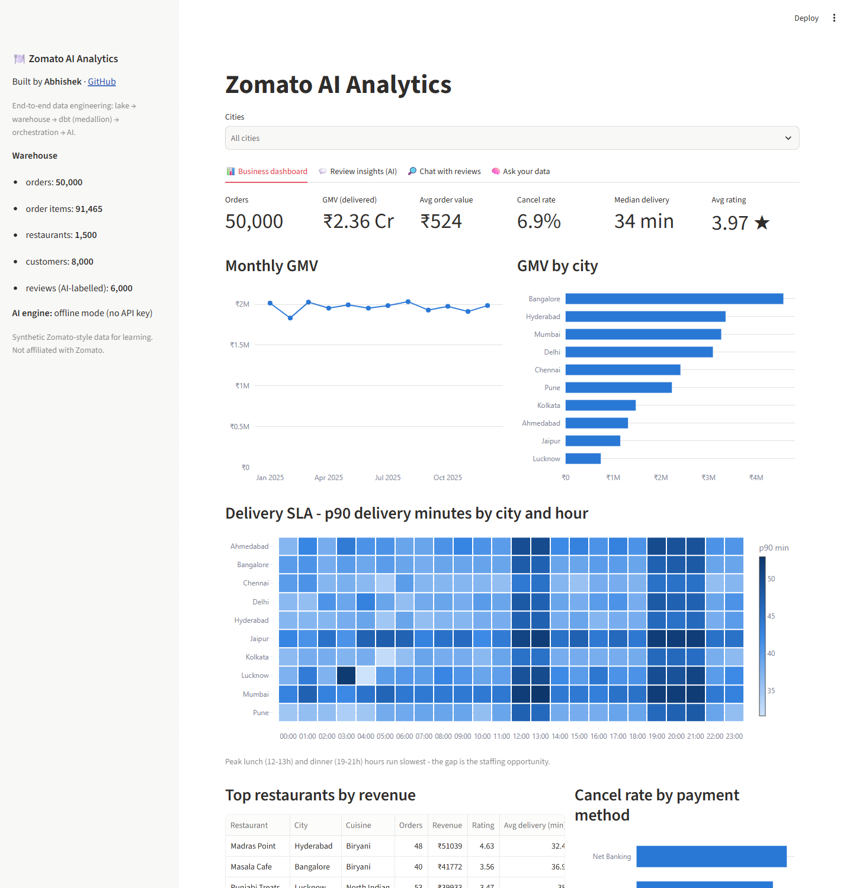
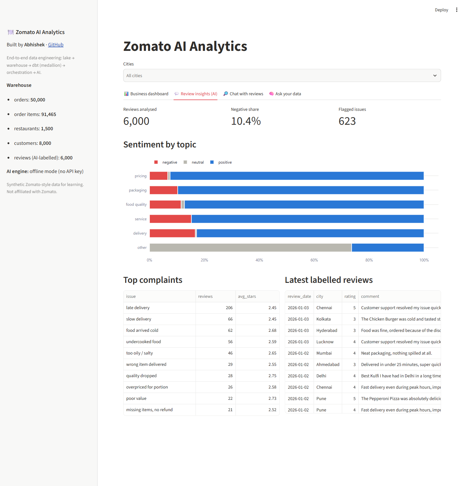
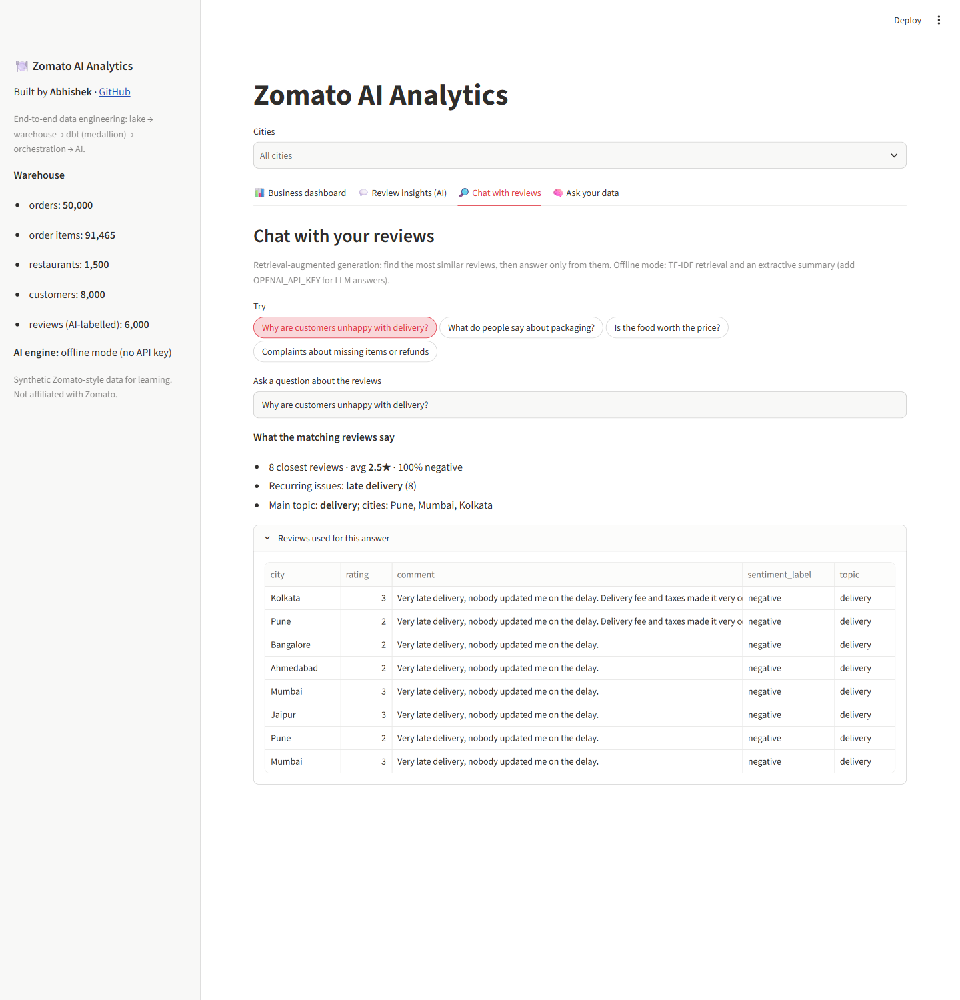
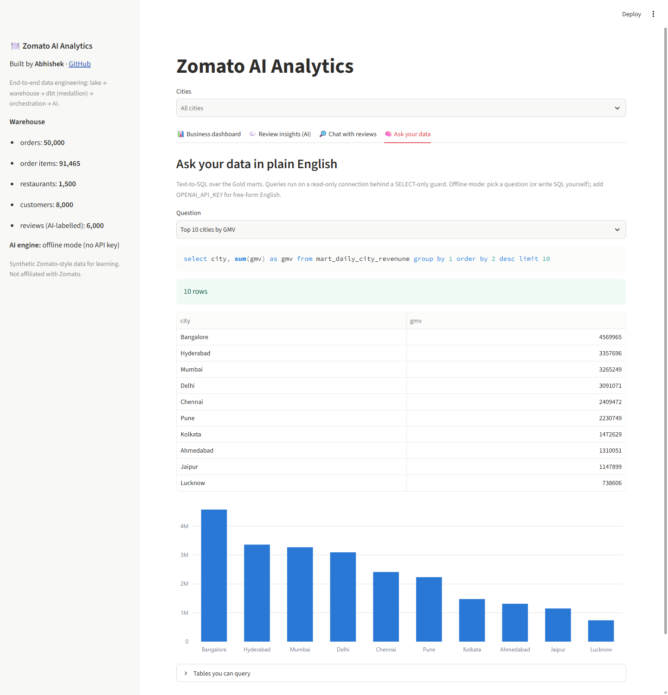

# Zomato AI Data Engineering — End-to-End Project

**By Abhishek** · [@GrayHatCoder](https://github.com/GrayHatCoder)

**Live demo: [abhishek-zomato-ai-analytics.streamlit.app](https://abhishek-zomato-ai-analytics.streamlit.app)** (if it has been idle, the first load wakes it up and rebuilds the warehouse in about a minute)

A complete batch data pipeline that takes Zomato-style food-delivery data from raw CSVs all the way to AI-powered analytics. It runs in two ways:

| | **Local mode** (runs on any laptop in about 30 seconds) | **Cloud mode** (production stack) |
|---|---|---|
| Lake | `data/lake/raw/<table>/` | Amazon S3 `s3://<bucket>/raw/<table>/` |
| Warehouse | DuckDB `warehouse/zomato.duckdb` | Snowflake `ZOMATO` database |
| Load (Bronze) | `local/load_raw.py` | `COPY INTO` through a keyless storage integration |
| Transform | **the same dbt models** (dbt-duckdb) | dbt-snowflake |
| Orchestrate | `run_pipeline.py` (same 4 tasks as the DAG) | Apache Airflow 3 on Docker |
| AI | OpenAI if a key is set, otherwise a free offline classifier | OpenAI `gpt-4o-mini` + embeddings |
| Serve | Streamlit app: dashboard, review insights, RAG, text-to-SQL | Streamlit |


## Quick start (local mode, no cloud accounts)

```bash
git clone https://github.com/GrayHatCoder/zomato-ai-data-engineering-end-to-end-project.git
cd zomato-ai-data-engineering-end-to-end-project

python -m venv .venv
# Windows: .venv\Scripts\activate      macOS/Linux: source .venv/bin/activate
pip install -r requirements.txt

python run_pipeline.py                 # generate data -> load -> dbt build + tests -> AI enrichment -> AI mart
streamlit run app/streamlit_app.py     # open http://localhost:8501
```

Output of one run:

```
=== [generate_data]  1,500 restaurants · 8,000 users · 50,000 orders · ~91K order items · 6,000 reviews
=== [reload_raw]     7 RAW (Bronze) tables loaded
=== [dbt_build_core] 16 models + 16 data tests  -> PASS=33 ERROR=0
=== [enrich_reviews] 6,000 reviews labelled (sentiment, topic, key issue)
=== [dbt_build_ai]   mart_review_insights        -> PASS=2 ERROR=0
Pipeline finished in ~20s
```

**Optional AI upgrade:** copy `example.env` to `.env` and add `OPENAI_API_KEY=sk-...`. Enrichment, RAG chat and text-to-SQL then switch to `gpt-4o-mini` and `text-embedding-3-small`. Without a key everything still works offline.

`python run_pipeline.py --fresh --orders 500000` regenerates a bigger dataset and rebuilds from scratch.

## The app

| Business dashboard | Review insights (AI) |
|---|---|
|  |  |
| **Chat with reviews (RAG)** | **Ask your data (text-to-SQL)** |
|  |  |

1. **Business dashboard**: GMV, AOV, cancel rate, delivery time and rating KPIs; monthly GMV; GMV by city; a delivery SLA heatmap (p90 minutes by city and hour); top restaurants; cancel rate by payment method. A city filter applies to everything.
2. **Review insights (AI)**: sentiment by topic, top complaints and labelled reviews, all from `mart_review_insights`.
3. **Chat with reviews (RAG)**: retrieves the most similar reviews and answers only from them, showing the source reviews.
4. **Ask your data (text-to-SQL)**: English to SQL over the Gold marts, behind a SELECT-only guard on a read-only connection.

## What gets built

| Layer | Where | What |
|---|---|---|
| **Source** | `data/` | 4 messy dimension CSVs (restaurants, users, food, menu) + 3 fact files (orders, order items, free-text reviews) |
| **Lake** | S3 / local folder | One folder per table under `raw/` |
| **Bronze** | `RAW` schema | One table per CSV, column order matching the files |
| **Silver** | `STAGING` schema | dbt staging views: clean, type and rename every source (`--` → null, `₹ 200` → 200, city after the last comma) |
| **Gold** | `MARTS` schema | Dimensions, **incremental** facts (MERGE) and business marts |
| **AI** | `AI` schema | LLM-enriched reviews (sentiment, topic, key issue), RAG chat, text-to-SQL |
| **Orchestration** | Airflow / `run_pipeline.py` | `reload_raw → dbt_build_core → enrich_reviews → dbt_build_ai` |

## Repository structure

```
├── run_pipeline.py           # local orchestrator: same 4 tasks as the Airflow DAG
├── requirements.txt          # local-mode dependencies
├── app/streamlit_app.py      # dashboard + review insights + RAG + text-to-SQL
├── local/
│   ├── generate_data.py      #   Zomato-style dataset in the exact RAW CSV layout (seeded, any size)
│   ├── load_raw.py           #   Bronze load into DuckDB (local twin of COPY INTO)
│   ├── enrich_reviews.py     #   AI enrichment: OpenAI or offline classifier, idempotent
│   └── profiles/profiles.yml #   dbt profile for DuckDB (no secrets)
├── zomato/                   # dbt project, shared by both modes
│   ├── models/staging/       #   7 staging views (Silver) + sources + tests
│   ├── models/marts/         #   dims, incremental facts, business marts (Gold)
│   └── macros/               #   schema-name macro + duckdb_compat (Snowflake functions on DuckDB)
├── airflow/                  # Airflow 3 on Docker (cloud mode)
│   ├── Dockerfile · docker-compose.yaml · example.env
│   └── dags/zomato_batch.py
├── ai/                       # cloud-mode AI scripts (Snowflake + OpenAI)
├── snowflake/                # Snowflake setup SQL, run in order 01 → 05
├── aws/iam/                  # IAM policy + trust policies for the S3 ↔ Snowflake handshake
└── docs/                     # architecture diagram + app screenshots
```

## How one dbt project runs on both Snowflake and DuckDB

The models are written in Snowflake SQL (`try_to_number`, `iff`, `div0`, `initcap`, `regexp_substr`, `::number` ...). Rather than fork the models, an `on-run-start` hook ([`zomato/macros/duckdb_compat.sql`](zomato/macros/duckdb_compat.sql)) defines DuckDB macros with the same names and behaviour **only when the target is DuckDB**. On Snowflake the hook does nothing. The only model with a target switch is `dim_date`, because Snowflake's `generator()` table function has no direct DuckDB equivalent.

The incremental facts (`fct_orders`, `fact_order_items`) use the MERGE strategy on both engines, so a re-run processes only new orders.

## Cloud mode (S3 → Snowflake → dbt → Airflow → OpenAI)

### 1 · Data lands in S3
Upload the seven CSVs to `s3://<BUCKET>/raw/<table>/`, one folder per table (`restaurants/`, `users/`, `food/`, `menu/`, `orders/`, `order_items/`, `reviews/`). You can use the files `local/generate_data.py` writes to `data/lake/raw/`.

### 2 · S3 → Snowflake: one keyless handshake
Snowflake reads the bucket with **no stored keys**, using a storage integration and an IAM role ([`snowflake/02_storage_integration.sql`](snowflake/02_storage_integration.sql) plus [`aws/iam/`](aws/iam/)):

| File | Used for |
|---|---|
| [`s3-read-policy.json`](aws/iam/s3-read-policy.json) | IAM **policy**: read-only access to the bucket |
| [`snowflake-role-trust-policy-initial.json`](aws/iam/snowflake-role-trust-policy-initial.json) | IAM **role**: placeholder trust used at creation time |
| [`snowflake-role-trust-policy-final.json`](aws/iam/snowflake-role-trust-policy-final.json) | Final trust: Snowflake's IAM user ARN + external ID from `DESC INTEGRATION` |

Order: create the AWS policy and role → create the `STORAGE INTEGRATION` with the role ARN → `DESC INTEGRATION` to get `STORAGE_AWS_IAM_USER_ARN` and `STORAGE_AWS_EXTERNAL_ID` → paste both into the role's trust policy. Never re-run `CREATE OR REPLACE` on the integration afterwards, because that regenerates the external ID and breaks the trust.

### 3 · Load, transform, orchestrate
```bash
# Snowflake objects: run snowflake/01 → 05 in Snowsight

# dbt (needs zomato/profiles.yml with a snowflake target that reads SNOWFLAKE_* env vars)
cd zomato
export SNOWFLAKE_ACCOUNT=... SNOWFLAKE_USER=... SNOWFLAKE_PASSWORD=...
dbt debug && dbt build --exclude tag:ai

# Airflow
cd airflow
cp example.env .env          # fill SNOWFLAKE_*, OPENAI_API_KEY, SAMPLE_N
docker compose build && docker compose up -d
# http://localhost:8080 → un-pause zomato_batch → Trigger

# AI apps on Snowflake
export OPENAI_API_KEY=sk-...
python ai/enrich_reviews.py
streamlit run ai/rag_chat.py
streamlit run ai/text_to_sql.py
```

## Tech stack

Python · Pandas · DuckDB · Amazon S3 · Snowflake · dbt (dbt-duckdb / dbt-snowflake) · Apache Airflow 3 (Docker) · OpenAI (`gpt-4o-mini`, `text-embedding-3-small`) · scikit-learn (TF-IDF) · Streamlit · Plotly

## Credits

Built by following the cloud architecture from **Darshil Parmar's** [Zomato AI Data Engineering project](https://github.com/darshilparmar/zomato-ai-data-engineering-end-to-end-project) ([video walkthrough](https://youtu.be/kYwaNMQ3XT8)). The original commits are kept in this repository's history. My additions are the local mode (data generator, DuckDB warehouse, cross-engine dbt layer, pipeline runner), the offline AI fallback and the Streamlit analytics app.

The data is synthetic, for learning only. This project is not affiliated with Zomato.
